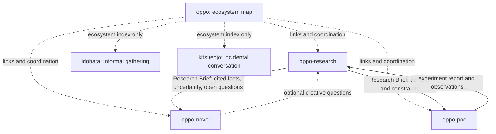

# oppo Ecosystem

## Purpose

The oppo ecosystem explores how people connect through telephone and voice media, how those experiences are remembered, and how they can be reimagined today.

The repositories are **loosely coupled projects**, not one application split across folders. Each repository owns its purpose, implementation, issues, and release cycle.

## Repository responsibilities

| Repository | Owns | Produces | Must not own |
|---|---|---|---|
| [oppo](https://github.com/bonsai/oppo) | Ecosystem map, shared vocabulary, research direction | This map, links, cross-project decisions | Research datasets, novel implementation, PoC runtime |
| [oppo-research](https://github.com/bonsai/oppo-research) | Historical research, sources, evidence, claims, ontology | Cited research notes and a portable Research Brief | Novel canon, PoC product decisions |
| [oppo-novel](https://github.com/bonsai/oppo-novel) | Fiction, characters, narrative structure | Manuscript and creative assets | Canonical historical evidence |
| [oppo-poc](https://github.com/bonsai/oppo-poc) | Product experiments and interaction validation | Runnable prototype, usability observations, experiment results | Historical source of truth |

## Adjacent conversation-space projects

These repositories are included as **independent neighboring projects**, not as modules or dependencies of `oppo`. Their repositories are currently empty, so the roles below are provisional interpretations of their names and should be confirmed before implementation.

| Repository | Provisional focus | Boundary with oppo |
|---|---|---|
| [idobata](https://github.com/bonsai/idobata) | An open, informal place for people to gather and talk (井戸端) | Owns its community/conversation experience; does not depend on oppo research or runtime |
| [kitsuenjo](https://github.com/bonsai/kitsuenjo) | A casual, incidental conversation space inspired by a smoking area (喫煙所) | Owns its own interaction rules and experience; does not depend on idobata or oppo |

Treat these as sibling experiments around **where and how people speak**, while `oppo` focuses on telephone/voice-media history and its reinterpretation. If they later exchange ideas, use links or small exported artifacts; do not create a shared database or shared application by default.

Repository names and boundaries can evolve independently. This table describes current intent, not a requirement that every repo be implemented now.

## Dependency direction

Dashed arrows to `idobata` and `kitsuenjo` mean **indexing only**; they do not imply a product integration. Other arrows represent **information handoffs**, not build-time or runtime dependencies. No repository should need another repository's source code, package installation, database, secrets, or deployment in order to function.

## Handoff contracts

Prefer small, versionable artifacts over direct coupling:

- **Research → Novel:** a Markdown Research Brief with source links, evidence level, known/uncertain details, and open questions. Creative inventions must be labeled as fiction.
- **Research → PoC:** a Markdown brief containing historical context, user needs, constraints, and hypotheses to test. The PoC must not present a hypothesis as verified history.
- **PoC → Research:** an experiment report with the question, method, observations, limitations, and links to relevant issues. User data is not copied into public research artifacts.
- **Novel → Research (optional):** specific research questions, not demands to change historical conclusions to fit the story.

Use Markdown and JSONL only where they make a handoff clearer. Keep schemas minimal and version them only when there is a real compatibility need.

## Evidence and provenance

Keep these categories distinct:

1. **Verified fact** — supported by traceable sources.
2. **Contemporaneous account** — a source created during the period being studied.
3. **Retrospective testimony** — a person's later recollection.
4. **Hearsay / unverified claim** — not independently confirmed.
5. **Hypothesis** — an interpretation to test.
6. **Fiction** — an intentional creative invention.

Every research claim should retain its source and uncertainty when exported. Downstream projects may interpret evidence, but must not silently rewrite the research source of truth.

## Loose-coupling rules

1. Each repo has its own README, issues, tests, and release/deployment lifecycle.
2. Cross-repo references are links to artifacts, not imports of implementation internals.
3. Prefer immutable commit links for research snapshots used by a novel or experiment; update to a newer snapshot deliberately.
4. Do not require synchronized releases. A consumer should continue working when another project is inactive or unavailable.
5. Share concepts and handoff formats, not hidden state or credentials.
6. Put cross-project decisions in this ecosystem document or a linked issue; put implementation tasks in the repo that owns the work.
7. Keep this map lightweight. Add infrastructure only after a demonstrated handoff problem.

## First useful integration

1. `oppo-research` publishes one cited Research Brief for a defined question.
2. `oppo-novel` can use that brief as background without importing research code.
3. `oppo-poc` can test one voice/telephone interaction using a separate brief.
4. Each consumer reports questions or findings back as links, leaving research evidence owned by `oppo-research`.

## Non-goals

- One monorepo or one shared runtime.
- A mandatory shared database or SDK.
- Automatic synchronization of every file between repositories.
- Treating fiction, memory, or prototype behavior as historical proof.
